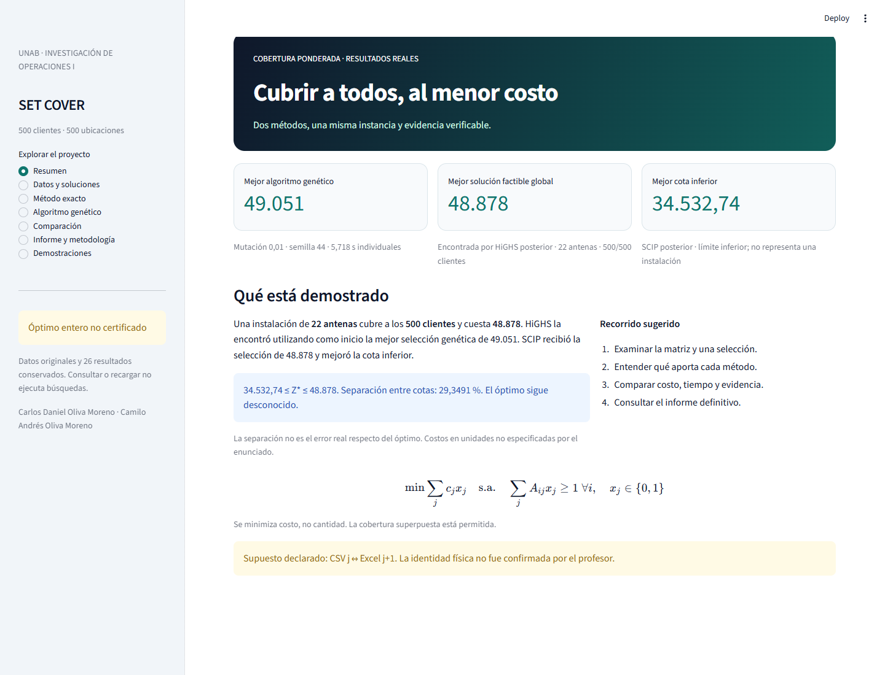

# SET COVER · Investigación de Operaciones I

Proyecto académico de **Carlos Daniel Oliva Moreno** y **Camilo Andrés Oliva Moreno**, Universidad Autónoma de Bucaramanga (UNAB). Docente: **Dilan Jhoanny Mogollon Carreño**. Entrega: **10 de noviembre de 2026**.

Seleccionar ubicaciones para cubrir a 500 clientes al menor costo de instalación. El modelo entero binario y el algoritmo genético usan la misma matriz 500×500 y los mismos costos. La interfaz permite explorar selecciones, cobertura, convergencia y cotas sin iniciar búsquedas al abrirse.

[](https://github.com/CDOM24/Set-Cover/actions/workflows/pruebas.yml)



**Acceso rápido:** [resultados](#resultados-y-significado) · [instalación](#instalar-y-ejecutar) · [Streamlit](#streamlit-community-cloud) · [informe PDF](docs/Informe_Proyecto_Oliva_Moreno.pdf).

**Aplicación web:** despliegue pendiente; por ahora se ejecuta localmente con `python -m streamlit run app.py`. No existe todavía una URL de Community Cloud.

## Resultados y significado

| Resultado | Costo / cota | Antenas | Cobertura | Tiempo de búsqueda |
|---|---:|---:|---:|---:|
| HiGHS inicial | 49.734 | 21 | 500/500 | 600,018 s |
| Mejor AG, mutación 0,01 y semilla 44 | 49.051 | 22 | 500/500 | 5,718 s individuales |
| HiGHS posterior, inicio en 49.051 | **48.878** | 22 | 500/500 | 7.193,594 s |
| SCIP posterior, inicio en 48.878 | 48.878; **cota 34.532,74** | 22 | 500/500 | 7.160,923 s |

**No hay óptimo certificado.** El intervalo es 34.532,73615154492 ≤ Z* ≤ 48.878; separación 100(U−L)/U ≈ **29,3491 %**. No es el error real respecto de un óptimo conocido. HiGHS encontró la mejora de costo; SCIP mejoró la cota. El tiempo del mejor AG no incluye las otras catorce corridas de su comparación ni el trabajo previo de otros experimentos.

Referencia principal: **[informe definitivo de 20 páginas](docs/Informe_Proyecto_Oliva_Moreno.pdf)**, descargado de Overleaf y suministrado por los autores. La captura de interfaz del informe es histórica; esta entrega incorpora los resultados posteriores en una nueva interfaz.

## Modelo y supuesto de datos

Minimizar `sum(c[j] * x[j])`, sujeto a `sum(A[i,j] * x[j]) >= 1` para cada cliente y `x[j]` binaria. Se permite cobertura superpuesta. Se minimiza costo, no cantidad de antenas.

Filas del CSV = clientes; columnas = antenas. Se mantiene el supuesto **CSV j ↔ Excel j+1** (0–499 frente a 1–500). La consistencia estructural está comprobada; la identidad física no fue confirmada por el profesor. No se presuponen moneda, coordenadas, interferencia ni capacidad.

## Instalar y ejecutar

Descargar este repositorio como ZIP o clonarlo con `git clone https://github.com/CDOM24/Set-Cover.git` y entrar en `Set-Cover`.

Requisito: **Python 3.12 de 64 bits**. Instalar las dependencias en un entorno nuevo dentro de la carpeta descargada de este repositorio.

```bash
python -m venv .venv
```

Windows (PowerShell), sin activar el entorno ni cambiar políticas:

En el equipo de revisión se instaló Python firmado en una carpeta de usuario separada, sin cambiar el PATH. Si `python` abre Microsoft Store, usa la ruta de la instalación oficial para crear el entorno. En este equipo fue:

```powershell
& "$env:LOCALAPPDATA\Programs\Python\Python312-SetCover\python.exe" -m venv .venv
```

No recrear un entorno que ya funciona. El instalador Windows 3.12.10 se usó para compatibilidad local; los experimentos históricos utilizaron 3.12.12. No se confunden esas versiones ni se afirma que 3.12.10 sea la última revisión de seguridad de la serie.

```powershell
.\.venv\Scripts\python.exe -m pip install -r requirements-dev.txt
.\.venv\Scripts\python.exe -m pip install --no-deps -e .
.\.venv\Scripts\python.exe -m pip check
.\.venv\Scripts\python.exe -m setcover.cli verificar
.\.venv\Scripts\python.exe -m pytest -q
.\.venv\Scripts\python.exe -m streamlit run app.py
```

Linux/macOS:

```bash
.venv/bin/python -m pip install -r requirements-dev.txt
.venv/bin/python -m pip install --no-deps -e .
.venv/bin/python -m pip check
.venv/bin/python -m setcover.cli verificar
.venv/bin/python -m pytest -q
.venv/bin/python -m streamlit run app.py
```

Abrir la dirección local que indique Streamlit. Para usar solo la aplicación, instalar `requirements.txt`; `requirements-dev.txt` añade las pruebas y la lectura del PDF. La verificación lee archivos persistidos, recalcula cobertura y costo y no optimiza. Las pruebas del solver y AG usan casos sintéticos pequeños, no repiten las campañas largas.

**Validación local realizada:** entorno nuevo con Python oficial firmado **3.12.10**, `pip check` correcto, auditoría Python de las 26 corridas, **108 pruebas aprobadas** y comprobación en Edge de las siete vistas, descargas, carga de originales y demostraciones. Se conserva el timeout inicial de AppTest; aprobó después sin cambiar código ni límite. También se documentan los ajustes de selectores del ensayo automatizado y el primer ensayo MILP sin descarga recuperable. Las demostraciones son pruebas separadas, no nuevos resultados del estudio. Véanse [validación](docs/VALIDACION.md) y [estado](ESTADO_PROYECTO.md). La comprobación continua en Linux se consulta en [GitHub Actions](https://github.com/CDOM24/Set-Cover/actions/workflows/pruebas.yml); Community Cloud sigue pendiente de despliegue.

## Streamlit Community Cloud

Repositorio público: `CDOM24/Set-Cover`, rama `main`, archivo **`app.py`**. Seleccionar **Python 3.12** al desplegar. `requirements.txt` en la raíz contiene las dependencias de la aplicación y el paquete `setcover/` está junto a `app.py`, por lo que la importación no depende de rutas personales ni de instalar un entorno local.

No fijamos dirección local ni puerto en la configuración. Las consultas no requieren credenciales ni compilar LaTeX. Los resultados se cargan desde el repositorio y las nuevas demostraciones están **desactivadas por defecto**. Mantener `SETCOVER_ENABLE_DEMOS` sin definir en Cloud. La URL pública se añadirá solo después de un despliegue autorizado y comprobado; no se presenta una URL ficticia.

[Documentación oficial de dependencias de Cloud](https://docs.streamlit.io/deploy/streamlit-community-cloud/deploy-your-app/app-dependencies).

## Estructura y evidencia

- `app.py`, `.streamlit/`: aplicación y presentación.
- `setcover/`: cargadores, modelo exacto, AG, variante con inmigrantes, verificador y catálogo.
- `datos/`: una copia de cada original, sin cambiar su orden ni su contenido.
- `resultados/indice.json`: catálogo explícito de **26 corridas**; `procedencia.json`: hashes y rutas de origen.
- `resultados/fase2/`, `fase3/`, `fase4/`: resultados históricos, incluidas las cinco corridas originales y las quince de comparación genética.
- `resultados/adicionales/`: únicamente evidencia necesaria de las dos investigaciones posteriores; sin supervisores ni lanzadores internos.
- `docs/`: informe definitivo, formulación, bibliografía y guías.
- `tests/`: regresiones y pruebas sintéticas; `.github/workflows/pruebas.yml`: comprobación automática en Linux.

Las copias de resultados conservan sus bytes originales. Los adaptadores de lectura interpretan los distintos formatos sin reescribir las corridas ni sustituir la conclusión histórica de Fase 4. [Reproducibilidad y límites](docs/REPRODUCIBILIDAD.md).

## Ejecuciones nuevas opcionales

Para una búsqueda local explícita y separada, por ejemplo:

```bash
python -m setcover.cli resolver --metodo ag --segundos 2 --semilla 44 --mutacion 0.01 --salida ejecucion_nueva
```

La carpeta de salida debe ser nueva; no se admiten salidas dentro de los datos ni resultados históricos. Para las interfaces nativas de HiGHS/SCIP instalar aparte `requirements-native.txt`. No hace falta para consultar la aplicación. Las ejecuciones nuevas no reproducen automáticamente tiempos, nodos ni árboles de búsqueda históricos.

Para habilitar demostraciones **locales** de 1–3 segundos: definir `SETCOVER_ENABLE_DEMOS=1` antes de iniciar Streamlit. Exigen botón y aceptación del supuesto, corren en un proceso con tiempo duro, admiten una a la vez por servidor y solo guardan resultados temporales descargables. No forman parte de los estudios ni actualizan récords.

## Alcance académico

Esta entrega presenta los métodos, resultados y limitaciones del informe. No altera el historial del proyecto de origen ni cambia la atribución de los resultados. Los materiales operativos de desarrollo no forman parte del producto publicado; la evidencia científica pertinente sí se conserva. Si la institución exige una declaración de herramientas de apoyo, debe cumplirse con información veraz.
La entrega pública se publica en `CDOM24/Set-Cover`, rama `main`, con `app.py` en la raíz. Se conserva la trazabilidad de la revisión privada aprobada; el repositorio original permanece intacto. El despliegue de la aplicación se realizará posteriormente desde la cuenta de los autores.
